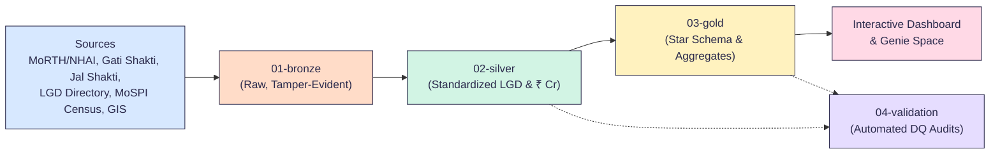

<p align="center">
  <h1 align="center">PragatiGati (प्रगति गति)</h1>
  <p align="center"><strong>Every project. Every rupee. Every district.</strong></p>
  <p align="center"><em>India National Infrastructure & PM Gati Shakti Monitoring Lakehouse Pipeline</em></p>
</p>

---

## Overview

**PragatiGati** is an end-to-end Databricks Lakehouse data pipeline and executive monitoring platform tracking public infrastructure investments across **India**. It harmonizes fragmented data from the **National Highways Authority of India (NHAI / MoRTH)**, **Dedicated Freight Corridor Corporation (DFCCIL / Railways)**, **Sagarmala Port Modernization (MoPSW)**, **Metro Rail / Smart Cities (MoHUA)**, and **Jal Shakti / Namami Gange Flood Management**.

All geographies are linked to official **Local Government Directory (LGD)** administrative codes and **Census / MoSPI** district demographic projections to reveal investment equity, regulatory bottlenecks, and seasonal construction risks.

---

## Core Analytical Questions

Our platform directly addresses the core infrastructure governance brief:

> *Where is central and state infrastructure capital (Capex) concentrated, how is it distributed across the 7 Engines of PM Gati Shakti, and which high-population regions and Aspirational Districts receive disproportionately low investment relative to their demographic needs?*

1. **Per-Capita Capital Allocation:** How much Capex (in ₹ Crores and ₹ per person) went to each State, Union Territory, and District?
2. **PARIVESH Regulatory Bottlenecks & Trapped Capex:** Which projects are stalled in Forest Clearance (Stage-I/II), Wildlife, CRZ, or Land Acquisition (LARR 2013) gates?
3. **"Ghost Progress" & Financial-Physical Disparity:** Does the percentage of funds disbursed match certified on-ground physical progress, or is there contractor front-loading?
4. **PM Gati Shakti Multi-Modal Balance:** How is capital distributed across the 7 Pillars: *Roads, Railways, Ports, Airports, Mass Transport, Waterways, and Logistics*?
5. **Aspirational Districts & Infrastructure Deficit:** Which of NITI Aayog's 112 Aspirational Districts are critically underserved?
6. **IMD Monsoon Impact Disruption:** Which construction packages face seasonal moratoriums and washouts during peak monsoon months (June–September)?

---

## Medallion Architecture



Each medallion layer is implemented as a schema within the `pragatigati-capstone` catalog:

| Schema | Role & Content |
| --- | --- |
| `00-source` | Raw JSON replies, GeoJSON geometries, and demographic spreadsheets in the `landing` volume. |
| `01-bronze` | High-fidelity raw tables preserving source structure, plus `_ingest_run_id`, `load_ts`, and SHA-256 digests in `load_log`. |
| `02-silver` | Cleaned and standardized entities: standardized currency (₹ INR Crores), LGD administrative codes, normalized dates. |
| `03-gold` | Production Star Schema (`dim_place`, `dim_gatishakti_engine`, `dim_agency`, `fact_project`) and analytical aggregations (`agg_state_equity`, `agg_gatishakti_summary`). |
| `04-validation` | Automated Data Quality checks, stop/flag action logging in `dq_results`. |

---

## Unique & Novel Analytical Features

1. **PM Gati Shakti Multi-Modal Engine Classification & Synergy**:
   - Automated tagging of project packages into Gati Shakti's 7 pillars and detection of intermodal connectivity synergy (e.g. rail-linked dry ports and port-connectivity expressways).
2. **PARIVESH 2.0 Clearance Bottleneck & Trapped Capex Engine**:
   - Isolates statutory approvals: Forest Stage-I/II, Environment (EC), Wildlife (NBWL), CRZ, and Land Right-of-Way. Computes "Trapped Capex" frozen in regulatory clearances.
3. **IMD Monsoon Impact & Seasonal Slippage Predictor**:
   - Cross-references project locations with IMD (India Meteorological Department) High-Intensity Rainfall zones and monsoon timing to forecast weather-induced delays.
4. **NITI Aayog Aspirational Districts Equity Deficit Index**:
   - Pinpoints districts where Capex per capita falls below 50% of the national/state average, quantifying the regional development gap.
5. **Contractor Health & Front-Loading Disparity Detector**:
   - Flags "Ghost Progress" where financial disbursements outpace verified physical milestone progress by >15%.

---

## Data Sources

| Source | Description |
| --- | --- |
| **MoRTH & NHAI Open Data** | National Highway & Expressway packages, Bharatmala Pariyojana, concession models (HAM/EPC/BOT). |
| **PM Gati Shakti National Master Plan** | Multi-modal logistics, Dedicated Freight Corridors (DFCCIL), Bullet Train, Metro rail. |
| **Ministry of Jal Shakti / FMBAP** | Flood mitigation, river embankment defenses, and Namami Gange wastewater infrastructure. |
| **Local Government Directory (LGD)** | Authoritative administrative hierarchy covering 28 States, 8 UTs, and 780+ Districts. |
| **MoSPI / Census of India** | District population projections and NITI Aayog Aspirational District classifications. |
| **Survey of India / Bharatmaps** | GIS boundary geometries and freight corridor alignments. |

---

## Quickstart

### 1. Run the Pipeline on Databricks

1. Clone this repository into your Databricks workspace.
2. Open `notebooks/00_setup/00_setup_workspace.sql` and run it to create the `pragatigati-capstone` catalog and schemas.
3. Run `notebooks/run_all.py` to execute Bronze ingestion, Silver standardization, Gold star schema creation, and automated validation checks.

### 2. Launch the Interactive Dashboard Locally

Run the built-in dashboard server:

```bash
python dashboard/app.py --port 8050 --open
```

Navigate to `http://localhost:8050/index.html` to explore the interactive GIS map, Gati Shakti analytics, clearance bottleneck matrix, and contractor scorecard!

### 3. Run Tests

```bash
python -m pytest tests
```
